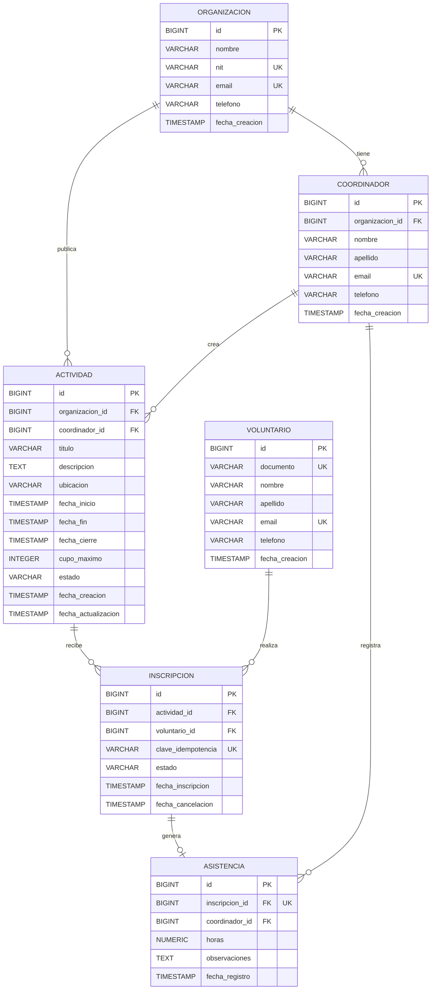

# ProyectoBackend

Backend para la **Gestión de voluntariado comunitario**: publica actividades, gestiona inscripciones y registra asistencia respetando cupos y fechas.

---

## Tecnologías

| Tecnología              | Versión / detalle                          |
|-------------------------|--------------------------------------------|
| Java                    | 21                                         |
| Spring Boot             | 4.1.1                                      |
| Spring Web MVC          | API REST                                   |
| Spring Data JPA         | Persistencia (Hibernate)                   |
| Jakarta Bean Validation | Validación de los DTOs de petición (`spring-boot-starter-validation`) |
| PostgreSQL              | Base de datos `DaMano_db`                  |
| Lombok                  | 1.18.46 (versión administrada por Spring Boot). Genera getters y constructores. |
| Maven                   | Usar el wrapper incluido: `./mvnw`         |

## Estado del proyecto

Seguimiento de lo implementado y lo pendiente. Actualizar esta tabla con cada avance.

| Componente                                         | Estado        | Detalle                                                              |
|----------------------------------------------------|---------------|----------------------------------------------------------------------|
| Endpoint de estado (`GET /api/estado`)             | Hecho     | Verifica que la API está disponible.                                 |
| Dependencias de persistencia (JPA + PostgreSQL)    | Hecho     | Agregadas en `pom.xml`.                                              |
| Modelo relacional de la base de datos              | Hecho     | Ver [Modelo de base de datos relacional](#modelo-de-base-de-datos-relacional). |
| Entidades JPA con relaciones `@ManyToOne`          | Hecho     | Ver [Implementación de entidades JPA](#implementación-de-entidades-jpa). |
| Conexión a `DaMano_db` en `application.properties` | Hecho     | La contraseña llega por la variable de entorno `DB_PASSWORD`. Ver [Configuración y ejecución](#configuración-y-ejecución). |
| Repositorios (`JpaRepository`)                     | Hecho     | Ver [Repositorios Spring Data JPA](#repositorios-spring-data-jpa).   |
| Query methods y primera consulta real              | Hecho     | Las seis entidades, comprobadas en `config/PersistenciaCheck.java`.  |
| Contrato de la API REST                            | Hecho     | Ver [Contrato de la API REST](#contrato-de-la-api-rest).             |
| DTOs de petición y respuesta                       | Hecho     | Ver [DTOs de petición y respuesta](#dtos-de-petición-y-respuesta).   |
| Lombok en entidades, `Response` e inyección de dependencias | Hecho | Entidades sin setters, `Response` inmutables y `@RequiredArgsConstructor` en servicios, controladores y `config/`. Ver [Convenciones del código](#convenciones-del-código). |
| Servicios con reglas de negocio (RN-01 a RN-06)    | En progreso | `OrganizacionServicio` hecho. Ver [Servicios y controladores](#servicios-y-controladores). |
| Controladores del contrato HTTP                    | En progreso | `OrganizacionController` hecho (endpoints 2 a 7). Faltan los demás del [resumen de endpoints](#resumen-de-endpoints). |
| Manejo de errores (400, 404, 409)                  | Pendiente | Los códigos ya se responden; falta el formato común del cuerpo de error. Ver [Códigos de estado HTTP](#códigos-de-estado-http). |

## Estructura del proyecto

```
src/main/java/co/edu/autonoma/reservasapi/
├── ProyectoBackendApplication.java   # Clase principal de Spring Boot
├── config/
│   └── PersistenciaCheck.java        # Comprobación temporal de persistencia al arrancar
├── controller/
│   ├── EstadoController.java         # GET /api/estado
│   └── OrganizacionController.java   # /api/organizaciones
├── dto/
│   ├── OrganizacionRequest.java                # record: POST y PUT de organizaciones
│   ├── CoordinadorRequest.java                 # record: POST de coordinadores
│   ├── CoordinadorActualizacionRequest.java    # record: PUT de coordinadores
│   ├── VoluntarioRequest.java                  # record: POST y PUT de voluntarios
│   ├── ActividadRequest.java                   # record: POST de actividades
│   ├── ActividadActualizacionRequest.java      # record: PUT de actividades
│   ├── ActividadEstadoRequest.java             # record: PATCH del estado de una actividad
│   ├── InscripcionRequest.java                 # record: POST de inscripciones
│   ├── AsistenciaRequest.java                  # record: PATCH de asistencia de una inscripción
│   ├── AsistenciaActualizacionRequest.java     # record: PUT de asistencias
│   ├── EstadoResponse.java                     # clase: respuesta de GET /api/estado
│   ├── OrganizacionResponse.java               # clase: respuesta de organizaciones
│   ├── ParticipacionOrganizacionResponse.java  # clase: resumen de participación de una organización
│   ├── ParticipacionActividadResponse.java     # clase: participación por actividad
│   ├── CoordinadorResponse.java                # clase: respuesta de coordinadores
│   ├── VoluntarioResponse.java                 # clase: respuesta de voluntarios
│   ├── ActividadResponse.java                  # clase: respuesta de actividades, con cupos
│   ├── InscripcionResponse.java                # clase: respuesta de inscripciones
│   └── AsistenciaResponse.java                 # clase: respuesta de asistencias
├── entity/
│   ├── OrganizacionEntity.java       # Entidad JPA → tabla organizacion
│   ├── CoordinadorEntity.java        # Entidad JPA → tabla coordinador
│   ├── VoluntarioEntity.java         # Entidad JPA → tabla voluntario
│   ├── ActividadEntity.java          # Entidad JPA → tabla actividad
│   ├── InscripcionEntity.java        # Entidad JPA → tabla inscripcion
│   ├── AsistenciaEntity.java         # Entidad JPA → tabla asistencia
│   ├── EstadoActividad.java          # Enum: estados de una actividad
│   └── EstadoInscripcion.java        # Enum: estados de una inscripción
├── repository/
│   ├── OrganizacionRepository.java   # JpaRepository<OrganizacionEntity, Integer>
│   ├── CoordinadorRepository.java    # JpaRepository<CoordinadorEntity, Integer>
│   ├── VoluntarioRepository.java     # JpaRepository<VoluntarioEntity, Integer>
│   ├── ActividadRepository.java      # JpaRepository<ActividadEntity, Integer>
│   ├── InscripcionRepository.java    # JpaRepository<InscripcionEntity, Integer>
│   └── AsistenciaRepository.java     # JpaRepository<AsistenciaEntity, Integer>
└── service/
    ├── EstadoServicio.java           # Lógica del endpoint de estado
    └── OrganizacionServicio.java     # Reglas y mapeo de organizaciones
```

| Paquete       | Contenido                                                               |
|---------------|-------------------------------------------------------------------------|
| `entity/`     | Clases `@Entity` y enums del negocio. Toda entidad termina en `Entity`. |
| `repository/` | Interfaces que extienden `JpaRepository`.                               |
| `dto/`        | Entrada y salida de la API: records `Request` y clases `Response`; ninguna clase `@Entity`. |
| `service/`    | Clases `@Service` terminadas en `Servicio`: reglas de negocio y conversión entidad a `Response`. |
| `controller/` | Clases `@RestController`: reciben DTOs, delegan en el servicio y devuelven el código HTTP. |
| `config/`     | Configuración y comprobaciones de arranque.                             |

## Configuración y ejecución

La conexión está en `src/main/resources/application.properties`. La contraseña de PostgreSQL no se escribe en el archivo: se lee de la variable de entorno `DB_PASSWORD`.

| Entorno            | Cómo definir la variable                                                          |
|--------------------|-----------------------------------------------------------------------------------|
| IntelliJ IDEA      | Run → Edit Configurations… → Environment variables: `DB_PASSWORD=tu_clave`         |
| Windows PowerShell | `$env:DB_PASSWORD="tu_clave"` y luego `.\mvnw.cmd spring-boot:run`                 |
| macOS / Linux      | `export DB_PASSWORD=tu_clave` y luego `./mvnw spring-boot:run`                     |

Lombok está declarado como dependencia `<optional>true</optional>` y excluido del jar en el `spring-boot-maven-plugin`, porque solo se usa al compilar. Se ejecuta como procesador de anotaciones, declarado en `annotationProcessorPaths` del `maven-compiler-plugin`. Desde el JDK 23, `javac` no lo ejecuta si solo está en el classpath. En IntelliJ IDEA debe estar activado Settings → Build, Execution, Deployment → Compiler → Annotation Processors → Enable annotation processing. Los avisos `sun.misc.Unsafe ... lombok.permit.Permit` que aparecen al compilar con JDK 25 son de Lombok y no impiden la compilación.

Si la consola muestra `password authentication failed for user "postgres"`, la variable no llegó a la aplicación: revisar el nombre y reiniciar la ejecución.

## Endpoints implementados

| Verbo  | Ruta                            | Descripción                                                  | Respuesta de ejemplo                                   |
|--------|---------------------------------|--------------------------------------------------------------|--------------------------------------------------------|
| GET    | `/api/estado`                   | Indica si la API está disponible.                            | `{"servicio": "DaMano-api", "estado": "disponible"}`   |
| GET    | `/api/organizaciones`           | Lista todas las organizaciones.                              | `[{"id": 1, "nombre": "...", "nit": "...", ...}]`      |
| GET    | `/api/organizaciones/{id}`      | Consulta una organización. 404 si no existe.                 | `OrganizacionResponse`                                 |
| GET    | `/api/organizaciones/nit/{nit}` | Busca una organización por NIT. 404 si no existe.            | `OrganizacionResponse`                                 |
| POST   | `/api/organizaciones`           | Registra una organización. 409 si el NIT o el correo ya existen. | `201` con la `OrganizacionResponse` creada              |
| PUT    | `/api/organizaciones/{id}`      | Reemplaza los datos. 404 si no existe; 409 si el NIT o el correo pertenecen a otra. | `OrganizacionResponse`              |
| DELETE | `/api/organizaciones/{id}`      | Elimina la organización. 409 si tiene coordinadores o actividades. | `204` sin cuerpo                                 |

## Contrato de la API REST

Diseño de las peticiones HTTP de la API. Están implementados `GET /api/estado` y los endpoints 2 a 7 de organizaciones; los demás están pendientes. Los DTOs que reciben y devuelven ya existen (ver [DTOs de petición y respuesta](#dtos-de-petición-y-respuesta)).

### Resumen de endpoints

La columna Estado indica si el endpoint ya está implementado (controlador y servicio). Actualizarla a medida que se implementa cada uno.

| #  | Verbo    | Ruta                                                 | Request                            | Response                              | Éxito | Estado    |
|----|----------|------------------------------------------------------|------------------------------------|---------------------------------------|-------|-----------|
| 1  | `GET`    | `/api/estado`                                        | —                                  | `EstadoResponse`                      | 200   | Hecho     |
| 2  | `GET`    | `/api/organizaciones`                                | —                                  | `List<OrganizacionResponse>`          | 200   | Hecho     |
| 3  | `GET`    | `/api/organizaciones/{id}`                           | —                                  | `OrganizacionResponse`                | 200   | Hecho     |
| 4  | `GET`    | `/api/organizaciones/nit/{nit}`                      | —                                  | `OrganizacionResponse`                | 200   | Hecho     |
| 5  | `POST`   | `/api/organizaciones`                                | `OrganizacionRequest`              | `OrganizacionResponse`                | 201   | Hecho     |
| 6  | `PUT`    | `/api/organizaciones/{id}`                           | `OrganizacionRequest`              | `OrganizacionResponse`                | 200   | Hecho     |
| 7  | `DELETE` | `/api/organizaciones/{id}`                           | —                                  | —                                     | 204   | Hecho     |
| 8  | `GET`    | `/api/organizaciones/{id}/coordinadores`             | —                                  | `List<CoordinadorResponse>`           | 200   | Pendiente |
| 9  | `GET`    | `/api/organizaciones/{id}/actividades`               | —                                  | `List<ActividadResponse>`             | 200   | Pendiente |
| 10 | `GET`    | `/api/organizaciones/{id}/participacion`             | —                                  | `ParticipacionOrganizacionResponse`   | 200   | Pendiente |
| 11 | `GET`    | `/api/coordinadores`                                 | —                                  | `List<CoordinadorResponse>`           | 200   | Pendiente |
| 12 | `GET`    | `/api/coordinadores/{id}`                            | —                                  | `CoordinadorResponse`                 | 200   | Pendiente |
| 13 | `GET`    | `/api/coordinadores/email/{email}`                   | —                                  | `CoordinadorResponse`                 | 200   | Pendiente |
| 14 | `POST`   | `/api/coordinadores`                                 | `CoordinadorRequest`               | `CoordinadorResponse`                 | 201   | Pendiente |
| 15 | `PUT`    | `/api/coordinadores/{id}`                            | `CoordinadorActualizacionRequest`  | `CoordinadorResponse`                 | 200   | Pendiente |
| 16 | `DELETE` | `/api/coordinadores/{id}`                            | —                                  | —                                     | 204   | Pendiente |
| 17 | `GET`    | `/api/coordinadores/{id}/actividades`                | —                                  | `List<ActividadResponse>`             | 200   | Pendiente |
| 18 | `GET`    | `/api/voluntarios`                                   | —                                  | `List<VoluntarioResponse>`            | 200   | Pendiente |
| 19 | `GET`    | `/api/voluntarios/{id}`                              | —                                  | `VoluntarioResponse`                  | 200   | Pendiente |
| 20 | `GET`    | `/api/voluntarios/documento/{documento}`             | —                                  | `VoluntarioResponse`                  | 200   | Pendiente |
| 21 | `POST`   | `/api/voluntarios`                                   | `VoluntarioRequest`                | `VoluntarioResponse`                  | 201   | Pendiente |
| 22 | `PUT`    | `/api/voluntarios/{id}`                              | `VoluntarioRequest`                | `VoluntarioResponse`                  | 200   | Pendiente |
| 23 | `DELETE` | `/api/voluntarios/{id}`                              | —                                  | —                                     | 204   | Pendiente |
| 24 | `GET`    | `/api/voluntarios/{id}/inscripciones?estado={estado}`| —                                  | `List<InscripcionResponse>`           | 200   | Pendiente |
| 25 | `GET`    | `/api/voluntarios/{id}/asistencias`                  | —                                  | `List<AsistenciaResponse>`            | 200   | Pendiente |
| 26 | `GET`    | `/api/actividades?estado={estado}`                   | —                                  | `List<ActividadResponse>`             | 200   | Pendiente |
| 27 | `GET`    | `/api/actividades/{id}`                              | —                                  | `ActividadResponse`                   | 200   | Pendiente |
| 28 | `POST`   | `/api/actividades`                                   | `ActividadRequest`                 | `ActividadResponse`                   | 201   | Pendiente |
| 29 | `PUT`    | `/api/actividades/{id}`                              | `ActividadActualizacionRequest`    | `ActividadResponse`                   | 200   | Pendiente |
| 30 | `PATCH`  | `/api/actividades/{id}/estado`                       | `ActividadEstadoRequest`           | `ActividadResponse`                   | 200   | Pendiente |
| 31 | `DELETE` | `/api/actividades/{id}`                              | —                                  | `ActividadResponse`                   | 200   | Pendiente |
| 32 | `GET`    | `/api/actividades/{id}/inscripciones?estado={estado}`| —                                  | `List<InscripcionResponse>`           | 200   | Pendiente |
| 33 | `GET`    | `/api/actividades/{id}/asistencias`                  | —                                  | `List<AsistenciaResponse>`            | 200   | Pendiente |
| 34 | `GET`    | `/api/inscripciones?estado={estado}`                 | —                                  | `List<InscripcionResponse>`           | 200   | Pendiente |
| 35 | `GET`    | `/api/inscripciones/{id}`                            | —                                  | `InscripcionResponse`                 | 200   | Pendiente |
| 36 | `POST`   | `/api/inscripciones`                                 | `InscripcionRequest`               | `InscripcionResponse`                 | 201 (200 si la clave ya existe) | Pendiente |
| 37 | `PATCH`  | `/api/inscripciones/{id}/asistencia`                 | `AsistenciaRequest`                | `AsistenciaResponse`                  | 200   | Pendiente |
| 38 | `DELETE` | `/api/inscripciones/{id}`                            | —                                  | `InscripcionResponse`                 | 200   | Pendiente |
| 39 | `GET`    | `/api/asistencias`                                   | —                                  | `List<AsistenciaResponse>`            | 200   | Pendiente |
| 40 | `GET`    | `/api/asistencias/{id}`                              | —                                  | `AsistenciaResponse`                  | 200   | Pendiente |
| 41 | `PUT`    | `/api/asistencias/{id}`                              | `AsistenciaActualizacionRequest`   | `AsistenciaResponse`                  | 200   | Pendiente |
| 42 | `DELETE` | `/api/asistencias/{id}`                              | —                                  | —                                     | 204   | Pendiente |

El parámetro `?estado=` es opcional en todas las rutas donde aparece. Si se omite, se devuelven todos los registros, salvo en `GET /api/actividades`, que sin filtro devuelve solo las actividades abiertas a inscripción.

### Códigos de estado HTTP

| Código             | Uso                                                                                                           |
|--------------------|---------------------------------------------------------------------------------------------------------------|
| `200 OK`           | Consulta, actualización, cancelación lógica o registro de asistencia (`PATCH`) exitoso.                       |
| `201 Created`      | Recurso creado. El cuerpo es la `Response` del nuevo recurso, con su `id`.                                    |
| `204 No Content`   | Eliminación física exitosa. Sin cuerpo.                                                                       |
| `400 Bad Request`  | Cuerpo inválido: validación de campos, fechas incoherentes, JSON mal formado o valor de enum desconocido.     |
| `404 Not Found`    | El recurso de la ruta, o un id referenciado en el cuerpo, no existe.                                          |
| `409 Conflict`     | Se viola una regla de negocio (RN-01 a RN-04, RN-06), un valor único, una dependencia que impide eliminar o el momento en que se permite la operación (editar una actividad con inscritos, cancelar una inscripción después del cierre). |

### Contrato HTTP mínimo del enunciado

El enunciado del proyecto exige estas seis operaciones. Todas están incluidas en el [resumen de endpoints](#resumen-de-endpoints).

| Verbo    | Ruta                                  | Responsabilidad según el enunciado                  | Cómo se cumple                                                             | Estado    |
|----------|---------------------------------------|-----------------------------------------------------|----------------------------------------------------------------------------|-----------|
| `GET`    | `/api/actividades`                    | Consulta abiertas.                                  | Sin filtro devuelve las actividades `ABIERTA` con `fechaCierre` futura.    | Pendiente |
| `GET`    | `/api/actividades/{id}/inscripciones` | Consulta del coordinador.                           | Inscripciones de la actividad, con filtro opcional `?estado=`.             | Pendiente |
| `POST`   | `/api/inscripciones`                  | Inscribe sin duplicar y controla cupo.              | Aplica RN-06, RN-03, RN-02 y RN-01, en ese orden.                          | Pendiente |
| `PUT`    | `/api/actividades/{id}`               | Reemplaza actividad antes de recibir inscripciones. | Responde 409 si la actividad ya tiene inscripciones `CONFIRMADA`.          | Pendiente |
| `PATCH`  | `/api/inscripciones/{id}/asistencia`  | Registra asistencia.                                | Crea la asistencia de la inscripción aplicando RN-04 y RN-05.              | Pendiente |
| `DELETE` | `/api/inscripciones/{id}`             | Cancela/elimina inscripción antes del cierre.       | Cancelación lógica; responde 409 si ya pasó `fechaCierre`.                 | Pendiente |

---

## Modelo de base de datos relacional

- **Motor:** PostgreSQL
- **Base de datos:** `DaMano_db`

### Entidades

| Entidad          | Tipo                  | Descripción                                                                                   |
|------------------|-----------------------|-----------------------------------------------------------------------------------------------|
| `organizacion`   | Fuerte                | Organización comunitaria que publica actividades y consulta la participación en ellas.       |
| `coordinador`    | Fuerte                | Usuario que pertenece a una organización, crea actividades y registra asistencia.            |
| `voluntario`     | Fuerte                | Usuario que consulta actividades y se inscribe en ellas.                                     |
| `actividad`      | Fuerte                | Actividad de voluntariado con cupo y fecha de cierre de inscripción.                         |
| `inscripcion`    | Débil (asociativa)    | Resuelve la relación N:M entre `voluntario` y `actividad`. No existe sin ambos.             |
| `asistencia`     | Débil                 | Registro de asistencia y horas de una inscripción confirmada. No existe sin la inscripción.  |

### Atributos

> **PK** = Clave primaria · **FK** = Clave foránea · **UQ** = Único · **NN** = No nulo

#### `organizacion`

| Atributo         | Tipo de dato   | Restricciones        | Descripción                         |
|------------------|----------------|----------------------|-------------------------------------|
| `id`             | `BIGINT`       | **PK**, identidad    | Identificador de la organización.   |
| `nombre`         | `VARCHAR(150)` | NN                   | Nombre de la organización.          |
| `nit`            | `VARCHAR(20)`  | NN, UQ               | Identificación tributaria.          |
| `email`          | `VARCHAR(150)` | NN, UQ               | Correo de contacto.                 |
| `telefono`       | `VARCHAR(20)`  |                      | Teléfono de contacto.               |
| `fecha_creacion` | `TIMESTAMP`    | NN, default `NOW()`  | Fecha de registro.                  |

#### `coordinador`

| Atributo          | Tipo de dato   | Restricciones                        | Descripción                         |
|-------------------|----------------|--------------------------------------|-------------------------------------|
| `id`              | `BIGINT`       | **PK**, identidad                    | Identificador del coordinador.      |
| `organizacion_id` | `BIGINT`       | **FK** → `organizacion(id)`, NN      | Organización a la que pertenece.    |
| `nombre`          | `VARCHAR(100)` | NN                                   | Nombres.                            |
| `apellido`        | `VARCHAR(100)` | NN                                   | Apellidos.                          |
| `email`           | `VARCHAR(150)` | NN, UQ                               | Correo electrónico.                 |
| `telefono`        | `VARCHAR(20)`  |                                      | Teléfono.                           |
| `fecha_creacion`  | `TIMESTAMP`    | NN, default `NOW()`                  | Fecha de registro.                  |

#### `voluntario`

| Atributo         | Tipo de dato   | Restricciones        | Descripción                         |
|------------------|----------------|----------------------|-------------------------------------|
| `id`             | `BIGINT`       | **PK**, identidad    | Identificador del voluntario.       |
| `documento`      | `VARCHAR(20)`  | NN, UQ               | Documento de identidad.             |
| `nombre`         | `VARCHAR(100)` | NN                   | Nombres.                            |
| `apellido`       | `VARCHAR(100)` | NN                   | Apellidos.                          |
| `email`          | `VARCHAR(150)` | NN, UQ               | Correo electrónico.                 |
| `telefono`       | `VARCHAR(20)`  |                      | Teléfono.                           |
| `fecha_creacion` | `TIMESTAMP`    | NN, default `NOW()`  | Fecha de registro.                  |

#### `actividad`

| Atributo              | Tipo de dato   | Restricciones                                                    | Descripción                                         |
|-----------------------|----------------|------------------------------------------------------------------|-----------------------------------------------------|
| `id`                  | `BIGINT`       | **PK**, identidad                                                | Identificador de la actividad.                      |
| `organizacion_id`     | `BIGINT`       | **FK** → `organizacion(id)`, NN                                  | Organización que publica la actividad.              |
| `coordinador_id`      | `BIGINT`       | **FK** → `coordinador(id)`, NN                                   | Coordinador que crea la actividad.                  |
| `titulo`              | `VARCHAR(150)` | NN                                                               | Título.                                             |
| `descripcion`         | `TEXT`         |                                                                  | Descripción.                                        |
| `ubicacion`           | `VARCHAR(200)` | NN                                                               | Lugar donde se realiza.                             |
| `fecha_inicio`        | `TIMESTAMP`    | NN                                                               | Inicio de la actividad.                             |
| `fecha_fin`           | `TIMESTAMP`    | NN, `CHECK (fecha_fin > fecha_inicio)`                           | Fin de la actividad.                                |
| `fecha_cierre`        | `TIMESTAMP`    | NN, `CHECK (fecha_cierre <= fecha_inicio)`                       | Fecha de cierre de inscripciones (RN-03).           |
| `cupo_maximo`         | `INTEGER`      | NN, `CHECK (cupo_maximo > 0)`                                    | Cupo total de voluntarios (RN-01).                  |
| `estado`              | `VARCHAR(20)`  | NN, `CHECK IN ('ABIERTA','CERRADA','CANCELADA','FINALIZADA')`    | Estado de la actividad.                             |
| `fecha_creacion`      | `TIMESTAMP`    | NN, default `NOW()`                                              | Fecha de creación.                                  |
| `fecha_actualizacion` | `TIMESTAMP`    | NN, default `NOW()`                                              | Última modificación (trazabilidad).                 |

#### `inscripcion`

| Atributo             | Tipo de dato   | Restricciones                                       | Descripción                                                   |
|----------------------|----------------|-----------------------------------------------------|---------------------------------------------------------------|
| `id`                 | `BIGINT`       | **PK**, identidad                                   | Identificador de la inscripción.                              |
| `actividad_id`       | `BIGINT`       | **FK** → `actividad(id)`, NN                        | Actividad a la que se inscribe.                               |
| `voluntario_id`      | `BIGINT`       | **FK** → `voluntario(id)`, NN                       | Voluntario inscrito.                                          |
| `clave_idempotencia` | `VARCHAR(100)` | NN, UQ                                              | Clave enviada por el cliente para no duplicar (RN-06).        |
| `estado`             | `VARCHAR(20)`  | NN, `CHECK IN ('CONFIRMADA','CANCELADA')`           | Estado de la inscripción.                                     |
| `fecha_inscripcion`  | `TIMESTAMP`    | NN, default `NOW()`                                 | Fecha en que se inscribió.                                    |
| `fecha_cancelacion`  | `TIMESTAMP`    |                                                     | Fecha de cancelación (cancelación lógica, trazabilidad).      |

#### `asistencia`

| Atributo          | Tipo de dato    | Restricciones                               | Descripción                                           |
|-------------------|-----------------|---------------------------------------------|-------------------------------------------------------|
| `id`              | `BIGINT`        | **PK**, identidad                           | Identificador de la asistencia.                       |
| `inscripcion_id`  | `BIGINT`        | **FK** → `inscripcion(id)`, NN, UQ          | Inscripción confirmada a la que corresponde (RN-04).  |
| `coordinador_id`  | `BIGINT`        | **FK** → `coordinador(id)`, NN              | Coordinador que registra la asistencia.               |
| `horas`           | `NUMERIC(5,2)`  | NN, `CHECK (horas > 0)`                     | Horas de voluntariado realizadas (RN-05).             |
| `observaciones`   | `TEXT`          |                                             | Observaciones del coordinador.                        |
| `fecha_registro`  | `TIMESTAMP`     | NN, default `NOW()`                         | Fecha en que se registró la asistencia.               |

### Claves primarias y foráneas

| Tabla          | Clave primaria | Clave foránea      | Referencia          |
|----------------|----------------|--------------------|---------------------|
| `organizacion` | `id`           | —                  | —                   |
| `coordinador`  | `id`           | `organizacion_id`  | `organizacion(id)`  |
| `voluntario`   | `id`           | —                  | —                   |
| `actividad`    | `id`           | `organizacion_id`  | `organizacion(id)`  |
|                |                | `coordinador_id`   | `coordinador(id)`   |
| `inscripcion`  | `id`           | `actividad_id`     | `actividad(id)`     |
|                |                | `voluntario_id`    | `voluntario(id)`    |
| `asistencia`   | `id`           | `inscripcion_id`   | `inscripcion(id)`   |
|                |                | `coordinador_id`   | `coordinador(id)`   |

### Relaciones

| Relación                              | Cardinalidad | Descripción                                                                                   |
|---------------------------------------|--------------|-----------------------------------------------------------------------------------------------|
| `organizacion` → `coordinador`        | 1 : N        | Una organización tiene muchos coordinadores; un coordinador pertenece a una organización.     |
| `organizacion` → `actividad`          | 1 : N        | Una organización publica muchas actividades; una actividad pertenece a una organización.     |
| `coordinador` → `actividad`           | 1 : N        | Un coordinador crea muchas actividades; una actividad es creada por un coordinador.          |
| `actividad` → `inscripcion`           | 1 : N        | Una actividad recibe muchas inscripciones; una inscripción es de una sola actividad.         |
| `voluntario` → `inscripcion`          | 1 : N        | Un voluntario tiene muchas inscripciones; una inscripción es de un solo voluntario.          |
| `voluntario` ↔ `actividad`            | N : M        | Resuelta mediante la entidad asociativa `inscripcion`.                                       |
| `inscripcion` → `asistencia`          | 1 : 0..1     | Una inscripción tiene como máximo un registro de asistencia.                                 |
| `coordinador` → `asistencia`          | 1 : N        | Un coordinador registra muchas asistencias.                                                  |

### Diagrama entidad-relación



### Reglas de negocio reflejadas en el modelo

| Regla | Cómo se soporta                                                                                                                                                  |
|-------|------------------------------------------------------------------------------------------------------------------------------------------------------------------|
| RN-01 | `actividad.cupo_maximo` con `CHECK > 0`. El servicio cuenta las inscripciones `CONFIRMADA` antes de insertar, bloqueando la actividad (`SELECT ... FOR UPDATE`). |
| RN-02 | Índice único parcial `(actividad_id, voluntario_id) WHERE estado = 'CONFIRMADA'`: solo puede existir una inscripción activa por voluntario y actividad.          |
| RN-03 | `actividad.fecha_cierre` y `actividad.estado`. El servicio rechaza la inscripción si `NOW() > fecha_cierre` o si el cupo está completo (pasa a `CERRADA`). Al consultar actividades, las que siguen `ABIERTA` con `fecha_cierre` vencida pasan a `CERRADA`. |
| RN-04 | `asistencia.inscripcion_id` es FK y único. El servicio valida que la inscripción esté en estado `CONFIRMADA` antes de registrar.                                 |
| RN-05 | `asistencia.horas` con `CHECK (horas > 0)`.                                                                                                                      |
| RN-06 | `inscripcion.clave_idempotencia` única: si se repite la petición con la misma clave, se devuelve la inscripción ya creada en lugar de crear otra.               |

> **Trazabilidad:** las inscripciones no se borran físicamente; `DELETE /api/inscripciones/{id}` cambia el estado a `CANCELADA` y guarda `fecha_cancelacion`. Solo se permite antes de `fecha_cierre` de la actividad.

---

## Implementación de entidades JPA

Cada tabla del modelo relacional tiene una clase Java anotada con `@Entity` en el paquete `co.edu.autonoma.reservasapi.entity`.

### Clase ↔ tabla

| Clase Java              | Tabla          | Relaciones `@ManyToOne`                                  |
|-------------------------|----------------|----------------------------------------------------------|
| `OrganizacionEntity`    | `organizacion` | — (no tiene claves foráneas)                             |
| `CoordinadorEntity`     | `coordinador`  | `organizacion` → `OrganizacionEntity`                    |
| `VoluntarioEntity`      | `voluntario`   | — (no tiene claves foráneas)                             |
| `ActividadEntity`       | `actividad`    | `organizacion` → `OrganizacionEntity`, `coordinador` → `CoordinadorEntity` |
| `InscripcionEntity`     | `inscripcion`  | `actividad` → `ActividadEntity`, `voluntario` → `VoluntarioEntity` |
| `AsistenciaEntity`      | `asistencia`   | `inscripcion` → `InscripcionEntity`, `coordinador` → `CoordinadorEntity` |

Las columnas se escriben en `snake_case` en la base de datos (`fecha_creacion`) y en `camelCase` en Java (`fechaCreacion`), mapeadas con `@Column(name = "...")`.

### Relaciones `@ManyToOne`

Las relaciones se definen **solo en el lado "muchos"** (la entidad que tiene la clave foránea). No hay `@OneToMany` en el lado "uno". Todas siguen el mismo patrón:

```java
@ManyToOne(fetch = FetchType.LAZY, optional = false)
@JoinColumn(name = "coordinador_id", nullable = false)
private CoordinadorEntity coordinador;
```

| Elemento                     | Para qué sirve                                                                                                   |
|------------------------------|------------------------------------------------------------------------------------------------------------------|
| `@ManyToOne`                 | Muchas filas de esta entidad apuntan a una sola fila de la otra (ej. muchas actividades → un coordinador).     |
| `fetch = FetchType.LAZY`     | La entidad relacionada se consulta solo cuando se llama a su getter. Evita consultas innecesarias (por defecto `@ManyToOne` es `EAGER`). |
| `optional = false`           | Hibernate valida en Java que la relación no sea `null` antes de guardar.                                         |
| `@JoinColumn(name = "...")`  | Nombre de la columna que guarda la clave foránea en la tabla.                                                    |
| `nullable = false`           | La columna se crea como `NOT NULL` en la base de datos.                                                          |

**Caso especial — `AsistenciaEntity.inscripcion`:** la relación inscripción–asistencia es 1 : 0..1. Se implementa con `@ManyToOne` y `@JoinColumn(..., unique = true)`, lo que garantiza una sola asistencia por inscripción.

> **Cuidado con `LAZY`:** la relación se consulta en la base de datos solo cuando se accede a ella, y para eso la sesión de Hibernate debe seguir abierta (ver [Mapeo entidad a respuesta](#mapeo-entidad-a-respuesta)). Aun así, los controladores devuelven DTOs de respuesta y no entidades: el JSON no depende de la estructura de las tablas ni expone los proxies que Hibernate usa para las relaciones `LAZY`.

### Enums de estado

Los estados se guardan como texto (`@Enumerated(EnumType.STRING)`), así la base de datos almacena `'ABIERTA'` y no un número.

| Enum                | Valores                                           | Valor inicial  | Usado en             |
|---------------------|---------------------------------------------------|----------------|----------------------|
| `EstadoActividad`   | `ABIERTA`, `CERRADA`, `CANCELADA`, `FINALIZADA`   | `ABIERTA`      | `ActividadEntity`    |
| `EstadoInscripcion` | `CONFIRMADA`, `CANCELADA`                         | `CONFIRMADA`   | `InscripcionEntity`  |

### Fechas automáticas

Las fechas de auditoría las asigna la propia entidad mediante callbacks de JPA; **no deben enviarse desde el cliente** y ningún constructor ni método las recibe.

| Callback       | Entidades                                         | Qué asigna                                                      |
|----------------|---------------------------------------------------|-----------------------------------------------------------------|
| `@PrePersist`  | Todas                                             | `fechaCreacion` / `fechaInscripcion` / `fechaRegistro` al insertar. |
| `@PreUpdate`   | `ActividadEntity`                                 | `fechaActualizacion` en cada modificación.                     |

`fechaCancelacion` no es automática: la asignará un método de `InscripcionEntity` al cancelar la inscripción, que se agrega junto con el servicio de inscripciones.

### Convenciones del código

- Las clases de entidad terminan en `Entity`.
- Las entidades solo llevan `@Getter` y `@NoArgsConstructor(access = AccessLevel.PROTECTED)` de Lombok. No tienen setters.
- El constructor vacío protegido es el que usa JPA para cargar filas. El código crea entidades con un constructor público que recibe los datos de su `Request`, y las modifica con métodos de la propia entidad (ver la tabla siguiente).
- Las entidades no usan `@Data`: su `equals`, `hashCode` y `toString` recorren todos los campos, incluidas las relaciones `LAZY`, lo que dispara consultas extra o `LazyInitializationException`.
- Llaves de apertura en línea nueva, igual que el resto del código.
- Identificadores `Integer` con `@GeneratedValue(strategy = GenerationType.IDENTITY)`.
- Montos decimales con `BigDecimal` (`horas` → `NUMERIC(5,2)`) y fechas con `LocalDateTime`.

| Entidad              | Constructor público                                                                                  | Métodos que la modifican |
|----------------------|------------------------------------------------------------------------------------------------------|--------------------------|
| `OrganizacionEntity` | `(nombre, nit, email, telefono)`                                                                     | `actualizar(nombre, nit, email, telefono)` para el `PUT` |
| `CoordinadorEntity`  | `(organizacion, nombre, apellido, email, telefono)`                                                  | Pendiente con su servicio |
| `VoluntarioEntity`   | `(documento, nombre, apellido, email, telefono)`                                                     | Pendiente con su servicio |
| `ActividadEntity`    | `(coordinador, titulo, descripcion, ubicacion, fechaInicio, fechaFin, fechaCierre, cupoMaximo)`. La organización se toma del coordinador y el estado inicial es `ABIERTA`. | Pendiente con su servicio |
| `InscripcionEntity`  | `(actividad, voluntario, claveIdempotencia)`. El estado inicial es `CONFIRMADA`.                     | Pendiente con su servicio |
| `AsistenciaEntity`   | `(inscripcion, coordinador, horas, observaciones)`                                                   | Pendiente con su servicio |

### Restricciones que las entidades no cubren

Las anotaciones JPA reflejan claves, `NOT NULL`, `UNIQUE` y longitudes, pero **no** estas restricciones del modelo. Deben crearse en la base de datos o validarse en los servicios:

| Restricción                                                         | Regla  |
|---------------------------------------------------------------------|--------|
| `CHECK (cupo_maximo > 0)`                                           | RN-01  |
| Índice único parcial `(actividad_id, voluntario_id) WHERE estado = 'CONFIRMADA'` | RN-02  |
| `CHECK (fecha_fin > fecha_inicio)` y `CHECK (fecha_cierre <= fecha_inicio)` | RN-03  |
| `CHECK (horas > 0)`                                                 | RN-05  |

---

## Repositorios Spring Data JPA

Cada entidad tiene una interfaz en `co.edu.autonoma.reservasapi.repository` que extiende `JpaRepository<Entidad, Integer>`. El segundo tipo genérico es el tipo del atributo `@Id`. No existe una clase de implementación: Spring Data la crea al arrancar la aplicación.

Todos los repositorios heredan `save`, `findById`, `findAll`, `count`, `existsById` y `deleteById`.

### Query methods

Spring Data genera la consulta a partir del nombre del método, usando los atributos Java de la entidad (no los nombres de columna).

| Repositorio              | Método                                                                     | SQL generado (resumen)                                                           | Uso previsto |
|--------------------------|----------------------------------------------------------------------------|----------------------------------------------------------------------------------|--------------|
| `OrganizacionRepository` | `findByNit(String)`                                                        | `select ... from organizacion where nit = ?`                                     | Buscar por identificación tributaria |
| `OrganizacionRepository` | `existsByNit(String)`, `existsByEmail(String)`                             | `select id from organizacion where nit = ?` (o `email = ?`)                      | `POST`: 409 si el valor único ya existe |
| `OrganizacionRepository` | `existsByNitAndIdNot(String, Integer)`, `existsByEmailAndIdNot(String, Integer)` | `select id from organizacion where nit = ? and id <> ?`                    | `PUT`: 409 si otra organización ya usa el valor |
| `CoordinadorRepository`  | `findByEmail(String)`                                                      | `select ... from coordinador where email = ?`                                    | Buscar por correo |
| `CoordinadorRepository`  | `existsByOrganizacionId(Integer)`                                          | `select id from coordinador where organizacion_id = ?`                           | `DELETE` de organización: 409 si tiene coordinadores |
| `VoluntarioRepository`   | `findByDocumento(String)`                                                  | `select ... from voluntario where documento = ?`                                 | Buscar por documento de identidad |
| `ActividadRepository`    | `findByEstado(EstadoActividad)`                                            | `select ... from actividad where estado = ?`                                     | Listar actividades por estado |
| `ActividadRepository`    | `countByEstado(EstadoActividad)`                                           | `select count(id) from actividad where estado = ?`                               | Contar actividades por estado |
| `ActividadRepository`    | `findByFechaCierreAfter(LocalDateTime)`                                    | `select ... from actividad where fecha_cierre > ?`                               | RN-03: inscripción aún abierta |
| `ActividadRepository`    | `existsByOrganizacionId(Integer)`                                          | `select id from actividad where organizacion_id = ?`                             | `DELETE` de organización: 409 si tiene actividades |
| `InscripcionRepository`  | `findByClaveIdempotencia(String)`                                          | `select ... from inscripcion where clave_idempotencia = ?`                       | RN-06: devolver la inscripción existente |
| `InscripcionRepository`  | `countByActividadIdAndEstado(Integer, EstadoInscripcion)`                  | `select count(id) from inscripcion where actividad_id = ? and estado = ?`        | RN-01: cupos ocupados |
| `InscripcionRepository`  | `existsByActividadIdAndVoluntarioIdAndEstado(Integer, Integer, EstadoInscripcion)` | `select id from inscripcion where actividad_id = ? and voluntario_id = ? and estado = ?` | RN-02: inscripción activa duplicada |
| `AsistenciaRepository`   | `existsByInscripcionId(Integer)`                                           | `select id from asistencia where inscripcion_id = ?`                             | RN-04: una asistencia por inscripción |

En nombres como `countByActividadIdAndEstado`, `ActividadId` recorre la relación `actividad.id`; Hibernate lo resuelve con la columna `actividad_id`, sin join.

### Comprobación de persistencia

`config/PersistenciaCheck.java` es un `CommandLineRunner` temporal que, en cada arranque, ejecuta `save()` en las seis entidades, muestra `count()` y `findAll()` de cada repositorio y el resultado de todos los query methods, junto con el SQL que genera Hibernate (`spring.jpa.show-sql=true`).

- La organización, el coordinador y el voluntario de prueba se buscan por `nit`, `email` y `documento` (columnas únicas) y se reutilizan si ya existen.
- Cada ejecución agrega una fila nueva en `actividad`, `inscripcion` y `asistencia`.
- Se retirará cuando existan los endpoints `GET`.

---

## DTOs de petición y respuesta

Los DTOs están en `co.edu.autonoma.reservasapi.dto`. Los controladores reciben y devuelven DTOs, nunca entidades.

| Tipo      | Sufijo     | Implementación                                                                                     |
|-----------|------------|----------------------------------------------------------------------------------------------------|
| Petición  | `Request`  | `record` inmutable. Cada componente lleva sus anotaciones de `jakarta.validation.constraints`.      |
| Respuesta | `Response` | Clase inmutable: campos `private final` con `@Getter` de Lombok y un constructor escrito a mano con todos los campos (no se usa `@AllArgsConstructor` ni `@RequiredArgsConstructor`). No tiene setters ni constructor vacío; Jackson genera el JSON a partir de los getters. Puede tener un método estático `desde(entidad)` que la construye (ver [Mapeo entidad a respuesta](#mapeo-entidad-a-respuesta)). |

### Clases de petición (`Request`)

| Record                            | Endpoint                                         | Campos                                                                                                  |
|-----------------------------------|--------------------------------------------------|---------------------------------------------------------------------------------------------------------|
| `OrganizacionRequest`             | `POST /api/organizaciones`, `PUT /api/organizaciones/{id}` | `nombre`, `nit`, `email`, `telefono`                                                          |
| `CoordinadorRequest`              | `POST /api/coordinadores`                        | `organizacionId`, `nombre`, `apellido`, `email`, `telefono`                                             |
| `CoordinadorActualizacionRequest` | `PUT /api/coordinadores/{id}`                    | Igual que `CoordinadorRequest` sin `organizacionId`: un coordinador no cambia de organización.          |
| `VoluntarioRequest`               | `POST /api/voluntarios`, `PUT /api/voluntarios/{id}` | `documento`, `nombre`, `apellido`, `email`, `telefono`                                              |
| `ActividadRequest`                | `POST /api/actividades`                          | `coordinadorId`, `titulo`, `descripcion`, `ubicacion`, `fechaInicio`, `fechaFin`, `fechaCierre`, `cupoMaximo` |
| `ActividadActualizacionRequest`   | `PUT /api/actividades/{id}`                      | Igual que `ActividadRequest` sin `coordinadorId` y sin exigir fechas futuras. Solo se acepta mientras la actividad no tenga inscripciones `CONFIRMADA`. |
| `ActividadEstadoRequest`          | `PATCH /api/actividades/{id}/estado`             | `estado` (`EstadoActividad`)                                                                            |
| `InscripcionRequest`              | `POST /api/inscripciones`                        | `actividadId`, `voluntarioId`, `claveIdempotencia` (RN-06)                                              |
| `AsistenciaRequest`               | `PATCH /api/inscripciones/{id}/asistencia`       | `coordinadorId`, `horas` (RN-05), `observaciones`. La inscripción va en la ruta.                        |
| `AsistenciaActualizacionRequest`  | `PUT /api/asistencias/{id}`                      | `horas`, `observaciones`                                                                                |

Ningún `Request` incluye el `id` del recurso (va en la ruta) ni los campos de auditoría (`fechaCreacion`, `fechaInscripcion`, etc.), que asigna el servidor.

### Validaciones

| Anotación                                       | Qué valida                                                         | Dónde se usa                                              |
|-------------------------------------------------|--------------------------------------------------------------------|-----------------------------------------------------------|
| `@NotNull`                                      | El campo no puede ser `null`.                                      | Ids referenciados, fechas, `cupoMaximo`, `estado`, `horas` |
| `@NotBlank`                                     | Texto no nulo y con al menos un carácter distinto de espacio.      | Nombres, documentos, correos, títulos, `claveIdempotencia` |
| `@Size(max = n)`                                | Longitud máxima, igual al `VARCHAR(n)` de la columna.              | Todos los campos de texto con límite                      |
| `@Email`                                        | Formato de correo electrónico.                                     | `email`                                                   |
| `@Future`                                       | Fecha posterior al momento actual.                                 | `fechaInicio` y `fechaCierre` de `ActividadRequest`       |
| `@Positive`                                     | Número mayor que cero (RN-01).                                     | `cupoMaximo`                                              |
| `@DecimalMin(value = "0.0", inclusive = false)` | Decimal mayor que cero (RN-05).                                    | `horas`                                                   |
| `@Digits(integer = 3, fraction = 2)`            | Hasta 3 enteros y 2 decimales, como la columna `NUMERIC(5,2)`.     | `horas`                                                   |

Las anotaciones solo se evalúan si el parámetro del controlador lleva `@Valid`. Si alguna falla, Spring lanza `MethodArgumentNotValidException` y la respuesta es `400 Bad Request`:

```java
@PostMapping
@ResponseStatus(HttpStatus.CREATED)
public ActividadResponse crear(@Valid @RequestBody ActividadRequest request)
```

Lo que no se puede expresar con anotaciones de un solo campo lo valida el servicio:

| Validación                                                    | Respuesta |
|---------------------------------------------------------------|-----------|
| `fechaFin > fechaInicio` y `fechaCierre <= fechaInicio` (RN-03) | 400       |
| Existencia de los ids referenciados en el cuerpo              | 404       |
| Valores únicos (`nit`, `email`, `documento`) y reglas RN-01 a RN-04 y RN-06 | 409 |
| Momento de la operación: `PUT` de una actividad con inscripciones `CONFIRMADA`, cancelación de una inscripción después de `fechaCierre` | 409 |

### Clases de respuesta (`Response`)

| Clase                               | Endpoints                                                                  | Campos que no están en la entidad                                                                                  |
|-------------------------------------|----------------------------------------------------------------------------|--------------------------------------------------------------------------------------------------------------------|
| `EstadoResponse`                    | `GET /api/estado`                                                          | —                                                                                                                  |
| `OrganizacionResponse`              | `/api/organizaciones`                                                      | —                                                                                                                  |
| `ParticipacionOrganizacionResponse` | `GET /api/organizaciones/{id}/participacion`                               | Totales de actividades, inscripciones `CONFIRMADA`, asistencias y horas; lista de `ParticipacionActividadResponse`. |
| `ParticipacionActividadResponse`    | Dentro de `ParticipacionOrganizacionResponse`                              | `inscripcionesConfirmadas`, `asistencias` y `horas` de cada actividad.                                             |
| `CoordinadorResponse`               | `/api/coordinadores`, `/api/organizaciones/{id}/coordinadores`             | `organizacionId` y `organizacionNombre`, tomados de la relación `organizacion`.                                    |
| `VoluntarioResponse`                | `/api/voluntarios`                                                         | —                                                                                                                  |
| `ActividadResponse`                 | `/api/actividades`, `/api/organizaciones/{id}/actividades`, `/api/coordinadores/{id}/actividades` | `organizacionNombre`, `coordinadorNombre`, `cuposOcupados` (`countByActividadIdAndEstado(id, CONFIRMADA)`) y `cuposDisponibles` (`cupoMaximo - cuposOcupados`). |
| `InscripcionResponse`               | `/api/inscripciones`, `/api/actividades/{id}/inscripciones`, `/api/voluntarios/{id}/inscripciones` | `actividadTitulo` y `voluntarioNombre`.                                                     |
| `AsistenciaResponse`                | `/api/asistencias`, `PATCH /api/inscripciones/{id}/asistencia`, `/api/actividades/{id}/asistencias`, `/api/voluntarios/{id}/asistencias` | `actividadId`, `actividadTitulo`, `voluntarioId` y `voluntarioNombre` (a través de la inscripción), y `coordinadorNombre`. |

- Los campos `...Nombre` de coordinadores y voluntarios se forman con nombre y apellido: `"Laura Gómez"`.
- Los conteos (`cuposOcupados`, `asistencias`, `totalActividades`, etc.) son `long` primitivo: valen `0` cuando no hay registros y nunca llegan como `null`.
- `fechaCancelacion` de `InscripcionResponse` es `null` mientras la inscripción esté `CONFIRMADA`.
- Los enums `EstadoActividad` y `EstadoInscripcion` del paquete `entity` se reutilizan en los DTOs y viajan como texto (`"ABIERTA"`).

### Mapeo entidad a respuesta

La conversión de entidad a `Response` la hace un método estático `desde(entidad)` de cada `Response`, y el servicio lo llama: `findAll().stream().map(OrganizacionResponse::desde).toList()` para listas y `OrganizacionResponse.desde(organizacion)` para un solo registro. Por ahora solo `OrganizacionResponse` lo tiene; las demás lo recibirán junto con su servicio.

El servicio no usa `@Transactional`. Las relaciones `@ManyToOne` son `LAZY` (ver [Relaciones `@ManyToOne`](#relaciones-manytoone)), y leer `actividad.getCoordinador().getNombre()` funciona porque Spring Boot activa por defecto `spring.jpa.open-in-view`: la sesión de Hibernate queda abierta durante toda la petición HTTP. Fuera de una petición, por ejemplo en un `CommandLineRunner` como `PersistenciaCheck`, esa misma lectura lanza `LazyInitializationException`.

---

## Servicios y controladores

Cada recurso tiene un `@Service` en `service/` (sufijo `Servicio`) y un `@RestController` en `controller/` (sufijo `Controller`). Ambos reciben sus dependencias por constructor en campos `private final`; el constructor lo genera `@RequiredArgsConstructor` de Lombok. Lo mismo aplica a los componentes de `config/`.

| Capa        | Responsabilidad                                                                                              |
|-------------|--------------------------------------------------------------------------------------------------------------|
| Controlador | Define la ruta, valida el cuerpo con `@Valid`, delega en el servicio y devuelve el DTO directamente. El código de éxito distinto de 200 se fija con `@ResponseStatus`: `CREATED` (201) en `POST` y `NO_CONTENT` (204) en `DELETE`. No usa repositorios ni entidades. |
| Servicio    | Busca las entidades, aplica las reglas del contrato, guarda y convierte el resultado con `Response.desde(...)`. No usa `@Transactional`: cada llamada al repositorio se ejecuta en su propia transacción. |

### Organizaciones

`OrganizacionController` y `OrganizacionServicio` implementan los endpoints 2 a 7 del [resumen de endpoints](#resumen-de-endpoints).

| Método del servicio        | Endpoint                            | Regla                                                                                   |
|----------------------------|-------------------------------------|-----------------------------------------------------------------------------------------|
| `listarOrganizaciones()`   | `GET /api/organizaciones`           | —                                                                                       |
| `consultarOrganizacion(id)`| `GET /api/organizaciones/{id}`      | 404 si no existe.                                                                       |
| `consultarPorNit(nit)`     | `GET /api/organizaciones/nit/{nit}` | 404 si no existe.                                                                       |
| `crearOrganizacion(...)`   | `POST /api/organizaciones`          | 409 si el `nit` o el `email` ya existen.                                                |
| `actualizarOrganizacion(...)` | `PUT /api/organizaciones/{id}`   | 404 si no existe; 409 si el `nit` o el `email` pertenecen a otra organización.          |
| `eliminarOrganizacion(id)` | `DELETE /api/organizaciones/{id}`   | 404 si no existe; 409 si tiene coordinadores o actividades (eliminación física).        |

Los endpoints 8 a 10 (`/coordinadores`, `/actividades` y `/participacion` de una organización) quedan pendientes: devuelven `CoordinadorResponse`, `ActividadResponse` y el resumen de participación, cuyo mapeo pertenece a los servicios de esas entidades.

### Errores mientras no exista el manejador global

El servicio lanza `ResponseStatusException` con `404` o `409`, y Spring responde con ese código. Un cuerpo inválido (`@Valid`) o un JSON mal formado responde `400`. El cuerpo de error es el predeterminado de Spring Boot; el formato propio de la API queda para la capa de [manejo de errores](#estado-del-proyecto).
